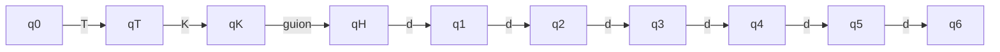

# Informe técnico

Analizador determinista de sesiones de soporte de internet. El dominio es falta de conexión, lentitud, cortes, reinicio del router y seguimiento de tickets. No interpreta español libre, ironía ni audio: si una construcción no está en la gramática, queda `NO_INTERPRETADO`.

El diccionario de vocabulario y la tabla de símbolos son estructuras distintas. El primero clasifica y corrige palabras. La segunda registra, por sesión, el identificador, los roles y los tickets.

## Pipeline

1. Se separan las sesiones (`SESION Sxx` … `FIN`) y se rechazan turnos con rol u orden inválidos.
2. Cada texto de turno se normaliza solo para clasificar.
3. Se corrige con Levenshtein, distancia 1 y candidato único.
4. El léxico emite tokens con sesión, turno y desplazamiento.
5. El parser LL(1) arma cláusulas y dispara una acción semántica por producción.
6. La tabla de símbolos inserta o actualiza roles y tickets.
7. Se resume cada aspecto y se infiere el estado.

## Léxico y normalización

La normalización pasa a minúsculas y quita marcas diacríticas (`está` → `esta`). El lexema original se conserva. La posición es `sesión / turno / desplazamiento`, con el desplazamiento medido en el texto del turno.

Prioridad al clasificar una pieza:

1. Ticket, reconocido por el AFD (no por una corrección).
2. Número, o la palabra `no`. No se modifican.
3. Coincidencia exacta con el vocabulario.
4. Si no hay coincidencia, Levenshtein contra los lemas de contenido.

Categorías de contenido: servicio (`servicio`, `internet`, `conexion`, `router`, `red`, `wifi`), adjetivos (`lento`, `lenta`, `mal`, `bien`, `amable`, `buena`, `bueno`), verbos de estado, atención, claridad, solicitud y compromiso, y la cortesía `gracias`. Las clases cerradas (`el`, `la`, `se`, `pero`, `muy`, `ahora`, `esta`, …) se reconocen exactas y no son destino de una corrección. `lenta` y `lento` están las dos a propósito.

## Expresión regular y AFD del ticket

Categoría mostrada: ticket.

```
TK-[0-9]{3,6}
```

El autómata se construye directo desde la expresión. El prefijo `TK-` es una cadena fija y los dígitos son un lazo acotado: menos de tres no acepta, más de seis cae al estado muerto. `d` es cualquier dígito. Cualquier otro símbolo también va a `qM`. Acepta `q3`, `q4`, `q5` y `q6` (tres a seis dígitos) y solo si se consumió toda la cadena. La comparación es en mayúsculas, así que `tk-204` es el mismo ticket `TK-204`.



`q3` a `q6` son de aceptación. Desde `q6`, otro dígito va a `qM`. Implementación: [src/afd_ticket.py](src/afd_ticket.py).

## Corrección

Se usa la distancia de Levenshtein con inserción, borrado y sustitución de costo 1. Hay corrección automática solo si existe un único lema de contenido a distancia 1: `lentto` → `lento` (y no `lenta`, que queda a distancia 2). Si hay dos, como `lent` frente a `lenta` y `lento`, se conserva el original y se registra el empate. No se tocan `no`, los números ni los tickets. Las palabras del agente `quedó`, `registrado` y `ticket` no tienen candidato a distancia 1, así que no se reescriben.

## Tabla de símbolos

Hash con encadenamiento separado. La función es el polinomio `h = h * 33 + código` módulo la capacidad. Cada entrada tiene clave, tipo (`sesion`, `participante` o `ticket`) y la lista de apariciones `{turno, desplazamiento}`.

- `buscar` recorre la cubeta y compara la clave.
- `insertar` rechaza la clave si ya existe.
- `actualizar` agrega una aparición a la entrada existente.
- El pipeline hace buscar y, según el resultado, insertar o actualizar. Por eso dos menciones de `TK-204` quedan en una sola entrada.

El ámbito es la sesión: cada sesión crea su tabla. El vocabulario no se guarda ahí.

## Gramática

Un enunciado es una cláusula, o dos unidas por `pero`. No se comparan frases enteras: `muy bien`, `sin internet` o `todos los días` se arman con tokens.

```
Enunciado     -> Clausula Resto
Resto         -> PERO Clausula Resto | ε
Clausula      -> NO RestoNo
               | AHORA FUNCIONA BienOpt
               | SE Corte
               | V_PERS RestoPers
               | Atencion
               | ART Nominal
               | SUST_SERVICIO Predicado
               | V_SOLICITUD ObjetoSol
               | V_COMPROMISO TicketOpt
               | MANANA V_COMPROMISO TicketOpt
               | FUNCIONA BienOpt
               | CORTESIA
               | Fragmento
RestoNo       -> FUNCIONA CompServ | V_CLARIDAD CompClar
CompServ      -> ART SUST_SERVICIO | ε
CompClar      -> ART SUST_CLARIDAD | ε
BienOpt       -> BIEN | ε
Corte         -> CORTA RecurrenciaOpt
RecurrenciaOpt-> TODOS ART DIAS | ε
RestoPers     -> ADJ_NEG | SIN SUST_SERVICIO
Atencion      -> ME V_ATENCION MuyAdj | V_ATENCION MuyAdj
MuyAdj        -> MUY AdjAt | AdjAt
AdjAt         -> ADJ_ATENCION | BIEN
ObjetoSol     -> ART SUST_SERVICIO | SUST_SERVICIO
TicketOpt     -> TICKET | ε
Nominal       -> SUST_SERVICIO Predicado
               | SUST_ATENCION COPULA MuyAdj
               | AGENTE_SUST COPULA MuyAdj
               | SUST_CLARIDAD
Predicado     -> COPULA MuyOpt Polaridad
               | ADJ_NEG
               | BIEN
               | SE Corte
               | ε
MuyOpt        -> MUY | ε
Polaridad     -> ADJ_NEG | BIEN
Fragmento     -> tokens hasta PERO o fin de turno
```

`MuyOpt` delante de `Polaridad` exige el adjetivo: si aparece `muy` y no hay adjetivo, la producción falla. `SUST_CLARIDAD` suelto solo se acepta si después viene `pero` o el fin; si no, no se inventa una mención neutra.

### FIRST, FOLLOW y por qué es LL(1)

El lookahead de `Clausula` es un solo token. Estos FIRST no se pisan:

| Alternativa | FIRST |
| --- | --- |
| negación | `NO` |
| recuperación con «ahora» | `AHORA` |
| corte | `SE` |
| persistencia | `V_PERS` (`sigue`, `sigo`) |
| atención verbal | `ME`, `V_ATENCION` |
| sintagma nominal | `ART` |
| servicio sin artículo | `SUST_SERVICIO` |
| solicitud | `V_SOLICITUD` |
| compromiso | `V_COMPROMISO` |
| compromiso con «mañana» | `MANANA` |
| «funciona» | `FUNCIONA` |
| cortesía | `CORTESIA` |
| fragmento | el complemento: `PALABRA`, `NUMERO`, `TICKET`, … |

`FOLLOW(Clausula) = {PERO, fin}`. `FOLLOW(Resto) = {fin}`.

Decisiones anulables, con FIRST y FOLLOW disjuntos:

- `BienOpt`: FIRST `{BIEN}`, FOLLOW `{PERO, fin}`. Si el lookahead no es `BIEN`, se reduce ε.
- `TicketOpt`: FIRST `{TICKET}`, FOLLOW `{PERO, fin}`.
- `RecurrenciaOpt`: FIRST `{TODOS}`. Solo se consume si a continuación están artículo y `DIAS`; si el grupo está incompleto, no se avanza.
- `CompServ` y `CompClar`: FIRST `{ART}`. El artículo se consume únicamente cuando el token siguiente es el sustantivo esperado. Si no, el artículo queda para el sobrante o para la cláusula que sigue. Esa mirada extra evita comerse un `el` que no pertenece al objeto.
- `Predicado` es ε cuando el lookahead está en `{PERO, fin, TICKET}`. `TICKET` se deja afuera del predicado para anotarlo como entidad. `FIRST(Predicado) = {COPULA, ADJ_NEG, BIEN, SE}`.

`Nominal` elige por un token entre `SUST_SERVICIO`, `SUST_ATENCION`, `AGENTE_SUST` y `SUST_CLARIDAD`. `RestoNo` elige entre `FUNCIONA` y `V_CLARIDAD`. `RestoPers` elige entre `ADJ_NEG` y `SIN`.

Si la alternativa que corresponde al primer token no se puede terminar, se rebobina ese intento y el tramo, hasta `pero` o el fin, sale como fragmento `R15`. Ninguna otra alternativa tiene el mismo primer token, así que no hay una segunda lectura exitosa del mismo inicio.

## Acciones semánticas

Cada producción que cierra una cláusula llama a una acción. El actor es el rol del turno. `negado` vale solo para la cláusula que empieza con `no`: `pero` abre otra cláusula con la negación en falso. `muy` intensifica y no cambia la polaridad.

| Regla | Producción | Resultado |
| --- | --- | --- |
| R1 | servicio + (`está`) + adjetivo negativo | `SERVICIO NEGATIVA`, falla |
| R2 | `ahora funciona` (`bien`) | `SERVICIO POSITIVA`, recuperación |
| R3 | `funciona` (`bien`) | `SERVICIO POSITIVA`, recuperación |
| R4 | `no funciona` (artículo + servicio) | `SERVICIO NEGATIVA`, falla, negado |
| R5 | `se corta` | `SERVICIO NEGATIVA`, corte |
| R6 | `se corta todos los días` | `SERVICIO NEGATIVA`, recurrencia |
| R7 | `sigue` / `sigo` + adjetivo negativo | `SERVICIO NEGATIVA`, falla |
| R8 | `sigue` / `sigo` + `sin` + servicio | `SERVICIO NEGATIVA`, falla |
| R9 | (`me`) `atendiste` (`muy`) `bien` | `ATENCION POSITIVA` |
| R10 | `el agente` + cópula + (`muy`) + amable | `ATENCION POSITIVA` |
| R11 | `no entendí` (artículo + explicación) | `CLARIDAD NEGATIVA`, negado |
| R12 | `reinicie` (artículo) + router o servicio | solicitud, sin valoración |
| R13 | (`mañana`) `revisaremos` (ticket) | compromiso futuro |
| R14 | `gracias` | cortesía, sin aspecto |
| R15 | fragmento | `NO_INTERPRETADO`, sin valoración |
| R16 | `la atención` + cópula + (`muy`) + adjetivo | `ATENCION POSITIVA` |
| R17 | servicio + cópula o adjetivo `bien` | `SERVICIO POSITIVA`, recuperación |
| R18 | mención de servicio o claridad sin polaridad | `NEUTRA` |

La opinión de un agente se guarda con su actor y no entra al resumen ni confirma el estado. Una solicitud no es un compromiso.

## Resumen y estado

El resumen usa solo evidencia del cliente. Si un aspecto tiene valoración positiva y negativa, es `MIXTA`. No se promedia ni se borra una de las dos. Sin evidencia interpretable, `SIN_EVIDENCIA`. Una mención sin polaridad, sola, es `NEUTRA`.

El estado mira las declaraciones del cliente sobre el funcionamiento, en orden, y se queda con la última:

- solo recuperación → `RESUELTO`
- solo falla, corte o recurrencia → `NO_RESUELTO`
- recuperación y falla en el mismo enunciado (`pero`) → `TEMPORAL`
- si el cliente no habló del funcionamiento y hay un compromiso → `PENDIENTE`
- si no → `NO_CONFIRMADO`

«Ahora funciona, pero se corta todos los días» es un solo enunciado con recuperación y recurrencia: `TEMPORAL`, y el aspecto queda `MIXTA`. «Se corta todos los días» sin recuperación es `NO_RESUELTO`. Una promesa del agente no pisa la última frase del cliente: si el cliente dijo que está lento, el estado sigue `NO_RESUELTO` aunque el agente diga que mañana revisará el ticket.

La sesión es `parcial` solo cuando se rechazó algo de la forma (rol, orden, línea en blanco, fin ausente). Un `NO_INTERPRETADO` no la vuelve parcial.

## Casos

Los ocho primeros son los de la guía. El 09 al 12 son propios: negación con contraste, corrección única, orden inconsistente y regresión por sinónimo. La salida obtenida es la que fijan las pruebas.

| Caso | Qué se comprueba | Obtenido |
| --- | --- | --- |
| 01 | lento y después «ahora funciona bien» | `SERVICIO MIXTA`, `RESUELTO` |
| 02 | «muy bien, pero sigo sin internet» | atención positiva, servicio negativo, `NO_RESUELTO` |
| 03 | «funciona, pero se corta todos los días» | `SERVICIO MIXTA`, `TEMPORAL` |
| 04 | «no entendí» y «fue amable» | claridad negativa, atención positiva, `NO_CONFIRMADO` |
| 05 | `lentto` y `TK-204` | corrige a `lento`, conserva `TK-204`, servicio negativo, `NO_RESUELTO` |
| 06 | «mañana revisaremos» y «gracias» | `PENDIENTE`, aspectos `SIN_EVIDENCIA` |
| 07 | rol `SOPORTE` y otra sesión | rechaza el turno, primera sesión parcial, la segunda sigue |
| 08 | `lent` con `{lenta, lento}` | empate, no corrige, `SIN_EVIDENCIA` |
| 09 | «no funciona, pero la atención fue muy buena» | servicio negativo, atención positiva, `NO_RESUELTO` |
| 10 | `conxion` | corrige a `conexion`, servicio negativo |
| 11 | el turno 3 llega sin el 2 | rechaza ese turno, no aplica «funciona bien», sesión parcial |
| 12 | regresión con `conexion` / `lenta` | igual que el 01: `MIXTA`, `RESUELTO` |

El caso 12 vuelve a pasar por R1 y R2 con otro sustantivo y otro adjetivo negativo. Si se cambia una de esas reglas, `pruebas/test_regresion.py` tiene que seguir en verde junto con el caso 01.

Hay además pruebas de «sigue lento», «funciona bien», «se corta» sin recuperación, de la precedencia frente a una promesa del agente, del ticket repetido en una sola entrada, y de una línea en blanco con fin ausente.

## Salida y traza

Un lote produce un JSON con `sesiones`. Cada una trae id, análisis `completo` o `parcial`, valoraciones por turno, resumen, estado, participantes, tickets con apariciones, correcciones, empates, errores y evidencias (turno, fragmento, regla, actor, negación). La consola repite eso en texto.

La traza de S01 está en [ejemplos/traza_s01.txt](ejemplos/traza_s01.txt). El orden es el del enunciado: texto original, tokens con posición, estructura, búsqueda e inserción en la tabla, acción semántica y resultado. En el turno 3 se ve `buscar CLIENTE — encontrado` y `actualizar`, porque el rol ya existía. El JSON del directorio `casos/` está en [ejemplos/salida.json](ejemplos/salida.json).

## Bibliotecas

Ninguna fuera de la biblioteca estándar. La declaración de IA y el lugar para los nombres del grupo están en [DECLARACION_IA.md](DECLARACION_IA.md).
